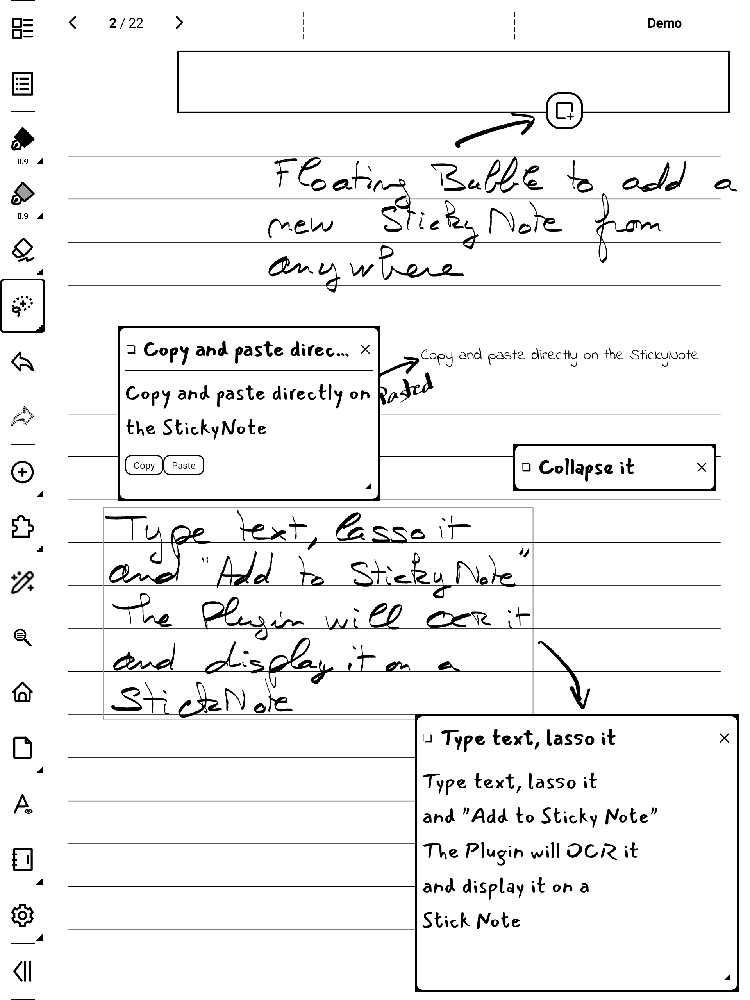

# SuperStickyNote

Floating sticky quick-notes for Supernote e-ink devices. Tap the bubble and a **sticky
note** appears on top of your notebook or document — write on it with the pen or type,
drag it aside, keep several open. Your thoughts land on the page without ever leaving what
you were doing.

And it works the other way round: **lasso your handwriting** or **select text in a PDF**,
and it becomes a sticky note that remembers where it came from.


## What it does

- **Sticky notes that float** over the NOTE and DOCUMENT apps — **written with the pen,
  or typed** (Settings → Mode); collapse, move, resize. 8 on screen by default, up to 40
  if you want them.
- **Capture handwriting** with the lasso: the sticky note keeps it **as you wrote it**,
  or recognised as text — in a notebook *or* on a PDF annotation.
- **Capture PDF text**: select it, tap the plugin button in the selection toolbar. No
  recognition needed.
- **Write on a sticky note with the pen**: the notebook's own pen, with an eraser and undo
  on the card. A lassoed capture becomes strokes you can erase and write over.
- **Put it back on the page**: the handwriting as real strokes — on a notebook or a PDF —
  or the text as an editable text box in the font and size you chose (notebooks).
- **Find them again**: every captured note links back to its file and page; filter by
  label, search the lot.

## Write on it

A handwritten sticky note writes with **the pen you picked in the notebook** — same pen,
size and grey — with its own eraser and undo in the header. Tap ✎, or just hold the pen
over the card.


## Capture from the page

Lasso handwriting in a notebook and it lands in a new sticky note — as strokes you can
erase and write over, or as recognised text, depending on Settings → Mode.


The same works on a **PDF**: lasso a handwritten annotation, or select the document's own
text and tap SuperStickyNote in the selection toolbar (circled below).


## Back to the page

A sticky note isn't a dead end: its handwriting goes back onto the page as real strokes
(a notebook or a PDF) — the bottom of the first picture above — and its text as a real,
editable text box on a notebook page.




## The Manager

Filters with counts on the left, search above the list, and the selected note's actions
right under it.


A note's own page: a handwritten note opens its sticky note to write on from there.


## Settings

The Mode (handwritten or typed notes), text size, the bubble, the capture frame,
backups — and every font you've dropped in `MyStyle/fonts`, each shown in its own
typeface.


## Install

1. Copy `superstickynote-<version>.snplg` (see [Releases](../../releases/latest)) to `MyStyle/` on the device.
2. **Settings → Apps → Plugins → Add Plugin** → pick the file.
3. Open a notebook — the bubble appears.

> **Which version do I need?** Supernote's firmware is called *Chauvet* — that's the
> platform name, so what matters is the version number (check it in device settings). This
> release targets **Chauvet 3.29.43 (Manta/Nomad) / 2.26.40 (A5 X / A6 X) or later**. A
> build made for one firmware version doesn't run on the other: devices on an earlier
> Chauvet need the previous release. Installing the wrong one shows *"package not
> compatible"* or the plugin does nothing. Verified on Manta/Nomad.

## Documentation

Everything else — every gesture, the underline-to-label trick, exports and backups, and
the known limits — is in the **[User Guide](USER_GUIDE.md)**. What changed in each
release is in the **[Changelog](CHANGELOG.md)**.

## Build

```bash
npm install
./buildPlugin.sh        # → build/outputs/SuperStickyNote.snplg
```
React Native 0.79.2 + `sn-plugin-lib`. The native overlay bridge is in
`android/app/src/main/java/com/superstickynote/`.

## Support

Free & made with love by a Supernote user, for Supernote users.
☕ **https://ko-fi.com/agp42**
