# SuperStickyNote for Supernote — User Guide

Floating sticky quick-notes for your Supernote. A small **launcher bubble** floats over
everything; tap it and a **sticky note** appears on top of your notebook or document.
Write on it with the pen or type with the keyboard, drag it around, keep several open at
once — your thoughts land on the page without ever leaving what you were doing.

And it works the other way too: lasso your handwriting, or select text in a PDF, and it
becomes a sticky note with a link back to where it came from.

> Works inside the **NOTE** and **DOCUMENT** apps. A sticky note is either
> **handwritten** (written with the pen) or **typed** (keyboard) — Settings → **Mode**
> (§6) decides what new ones are.
>
> **Firmware:** Supernote's firmware is called *Chauvet* — what matters is the version
> (check it in device settings). This release targets **Chauvet 3.29.43 (Manta/Nomad) /
> 2.26.40 (A5 X / A6 X) or later** and won't run on an earlier Chauvet; devices still on
> an earlier version need the previous release. Verified on Manta/Nomad.

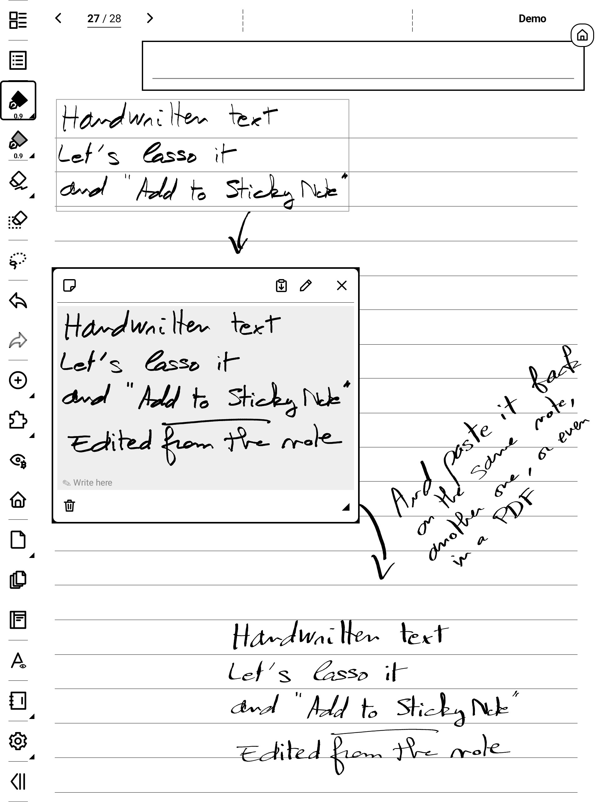

---

## 1. Install

1. Copy `superstickynote-<version>.snplg` to the `MyStyle/` folder on the device
   (via USB, or `adb push … /storage/emulated/0/MyStyle/`).
2. On the device: **Settings → Apps → Plugins → Add Plugin** → pick the file.
3. Open a notebook. The **launcher bubble** appears (top-right by default).

*Updating:* uninstall the old version first (Settings → Apps → Plugins), then add the new `.snplg`.

> **After removing the plugin, the bubble stays on screen** until you **restart the
> device** — the bubble is a system overlay owned by the plugin host, cleared when the
> process is recycled.

---

## 2. The bubble

The **launcher bubble** — a small note with a **+** — is always within reach.

- **Tap it** → creates a new sticky note, ready right away: to write on with the pen in
  **Handwriting** mode, with the keyboard open in **Text** mode.
- **Drag** it to move it anywhere.
- Don't want it on screen? Hide it from **Settings → Launcher bubble** (§6).

---

## 3. The sticky note

A sticky note floats on top of the page. The rest of the screen stays live — you can keep
writing in your notebook in the gaps between sticky notes.

| Gesture | What it does |
|---|---|
| **Tap the body** | Typed notes: edit — the keyboard opens and you type inline |
| **✎, or hold the pen over the card** | Handwritten notes: write with the pen (below) |
| **✓ (top-right)** | Finish editing or writing |
| **Tap the header bar** | Collapse / expand (collapsed shows only the title) |
| **Tap the icon** | Open the full list (Manager) |
| **Tap the labels** | Open the Manager (when the sticky note has labels) |
| **Drag the header** | Move the sticky note |
| **Drag the ◢ corner** | Resize (bottom-right) |
| **Long-press the body** | Typed notes: Copy / Paste bar |
| **Put on page (clipboard icon)** | Put the note on the page underneath (§8) |
| **✕ (top-right)** | Close the sticky note (it stays saved in the list) |
| **Bin (bottom-left)** | Delete the sticky note — tap twice: the first tap inverts the bin and asks *Tap the bin again* |

- **Saving is automatic** — text is saved as you type; tapping outside the sticky note
  also closes the keyboard.
- On a typed note the **first non-empty line** becomes the title (shown when collapsed
  and in the list).
- **Labels** show as chips in the header, display-only.
- **Long notes** fill the whole card and scroll — drag the ◢ corner to make the card bigger.
- **8 sticky notes on screen at once** by default, and you can raise that to **40**
  (§6). At the limit, creating another keeps it in the list instead of dropping one.
  **No limit** on total notes.
- **Move it with a finger, not the pen** — see *Good to know* below.

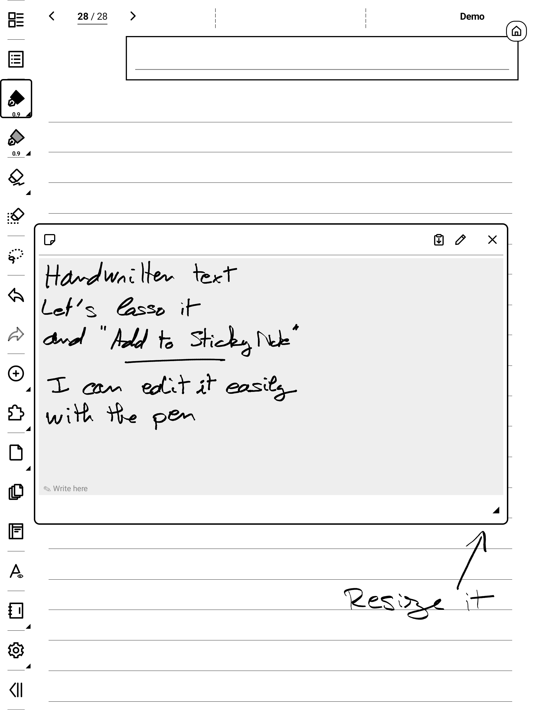

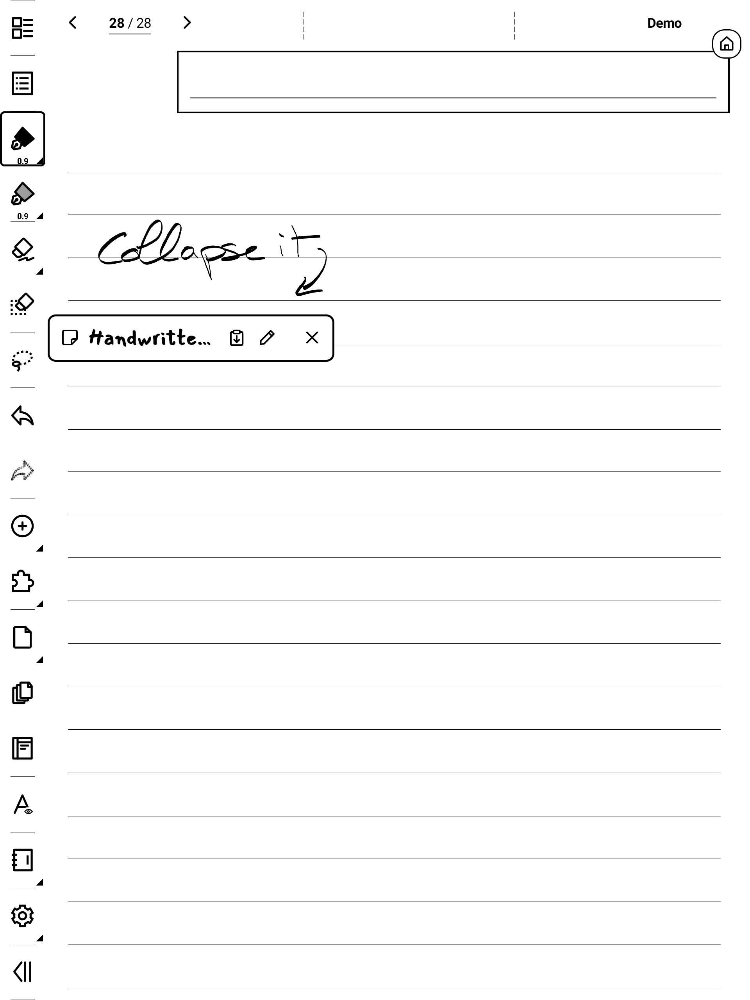

### Handwritten sticky notes

In **Handwriting** mode (Settings → Mode, §6), sticky notes are written with the pen
instead of typed. At rest a handwritten note is **grey, with "✎ Write here"** at the
bottom. Tap **✎** in the header — the bubble ✚ does it for you on a new note — and the
card turns white and framed: write anywhere in it, then tap **✓**. The ink shows as you
write, and nothing is written on the page under the card.

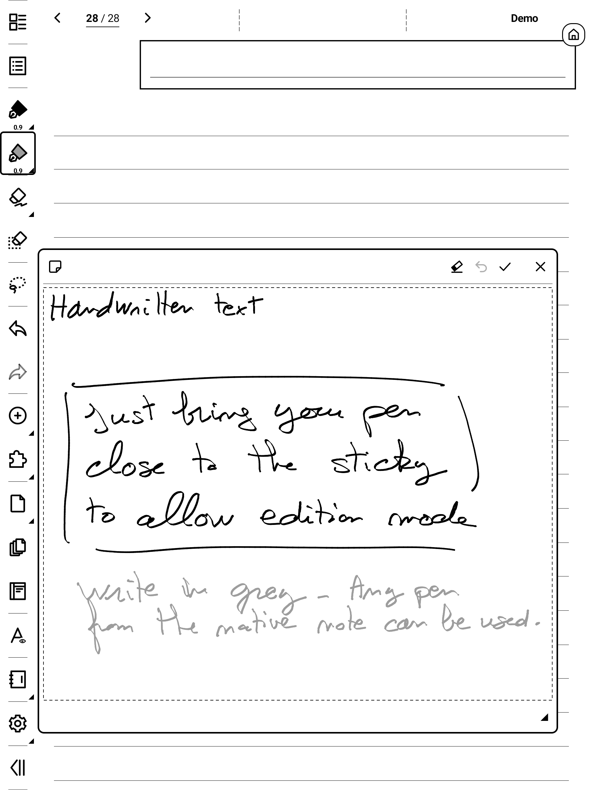

- **Tap ✎, or hold the pen still just above the card**, before writing. You can also just
  start writing on a grey card: it switches to writing at once, but that first stroke has
  already gone to the page underneath.
- The card writes with **the pen selected in the notebook**: same pen, size and grey. To
  write with another one, pick it in the notebook's toolbar first.
- **Erase** with the eraser in the header (it turns black while it is the tool) or with
  the pen's eraser end, and **↶** undoes the last stroke or erase. Both erase whole
  strokes.
- **Don't use the notebook's erasers on a card**: neither its eraser tool nor the
  two-finger eraser gesture reach the card's ink, and the gesture erases the page under
  the card instead.
- What you wrote is **kept**: it stays on the card and in the Manager. Tap ✎ again to add
  to it — or to erase part of a lassoed capture (§7).
- Writing also ends when you touch the page **with the pen** outside the card, close the
  card, or open the Manager. A finger or a resting palm doesn't end it.
- Move the card by its header with a **finger** while writing.
- A **new** handwritten note closed (✕) or hidden without anything written, titled or
  labelled on it is discarded; ✓ on it keeps it, empty, for later. An older one you erase
  completely is kept, with its title and labels.
- No title on the card unless you give one: the **Title** field of the note page (§5).
  Folded, an untitled one says "Handwritten note".
- Notes made before v3.1 can hold both text and a capture; they keep both, and the pen
  writes under the text.

---

## 4. The Manager

Open it from the **toolbar button**, or by **tapping a sticky note's icon or labels**.
Your open sticky notes **stay on top of the Manager**, so changing the font or text size
updates them **live**, and opening a note doesn't close the panel.

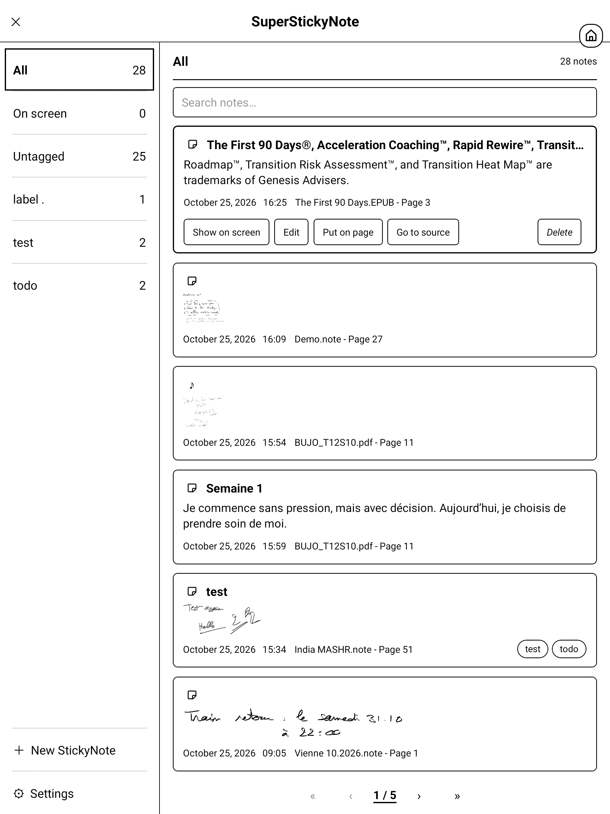

**The left rail** filters the list, with a count beside each entry:

- **All**, **On screen**, **Untagged**, then **one row per label**.
- **＋ New StickyNote** — pick an icon; a fresh sticky note floats on the page. Tap ✎ (or
  its body, for a typed one) to start.
- **⚙ Settings** — see §6.

**The list** shows one card per note: its icon, the title, the first lines, then the date
and — for a captured note — the file and page it came from. A note that is **on screen**
right now wears its icon in a black square. The list is **paged**: use
**« ‹ 1/3 › »** at the bottom. **Search** sits above the list and filters as you type, on
the text, titles and labels.

**Tap a card to select it**, and its buttons appear underneath:

| Button | What it does |
|---|---|
| **Show on screen / Hide** | Float this sticky note on the page, or take it off |
| **Edit** | Open the note page (§5) — *shortcut: press and hold the card* |
| **Put on page** | Put this note on the notebook page underneath: its handwriting if it has some, otherwise its text (§8) |
| **Go to source** | Jump back to the page this note was captured from |
| **Delete** | Remove the note — tap twice: the first tap asks *Tap again to delete* |

---

## 5. The note page

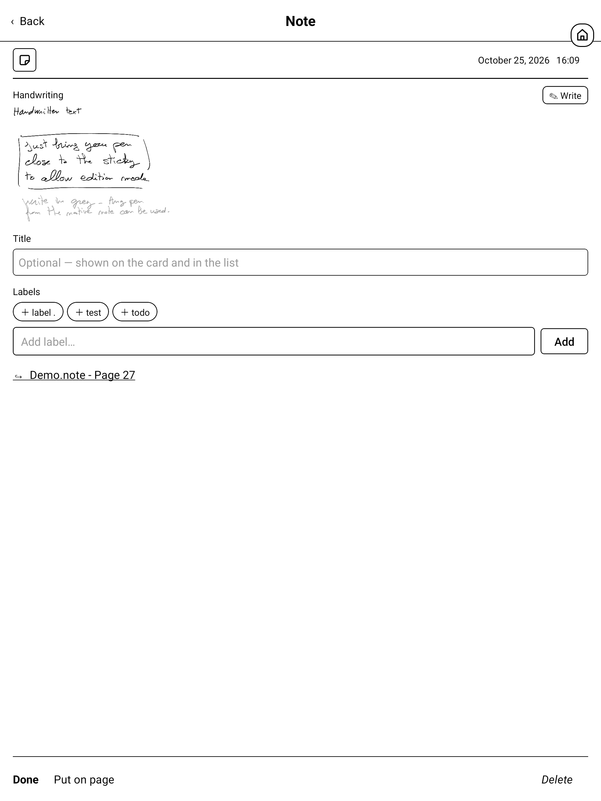

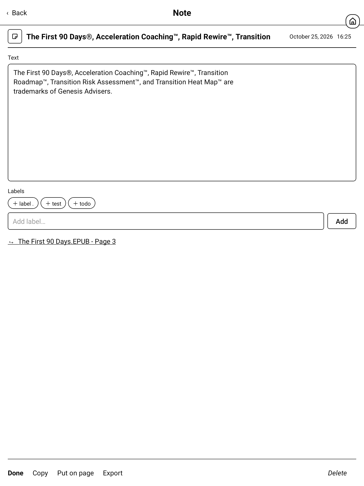

- **Handwriting** — on a handwritten note: what is written on it (§3). To write on it
  or erase, tap it or **✎ Write**: its sticky note floats up over the Manager, ready to
  write on — tap **✓** there and the page shows the result. The pen leaves no ink on
  the Manager itself. Notes captured before v3.1 show their capture here, read-only.
- **Title** — on a handwritten note: an optional title, shown on the card and in the
  list, and found by search.
- **Text** — on a typed note: edit the whole note. The same note can be open in its
  floating card at the same time; both stay in step.
- **Icon** — tap the icon beside the title to change it (symbols and digits 0–9).
- **Labels** — type one and tap **Add**, or tap a suggestion. Tap a label to remove it.
- **↪ source line** — only on captured notes: jumps back to the notebook or document page
  it came from, opening the file if it isn't already open.
- **Done · Copy · Put on page · Export · Delete** along the bottom. A handwritten note
  has no Copy or Export (it has no text). A note from before v3.1 holding both has
  **Put ink on page** and **Put text on page**.

---

## 6. Settings

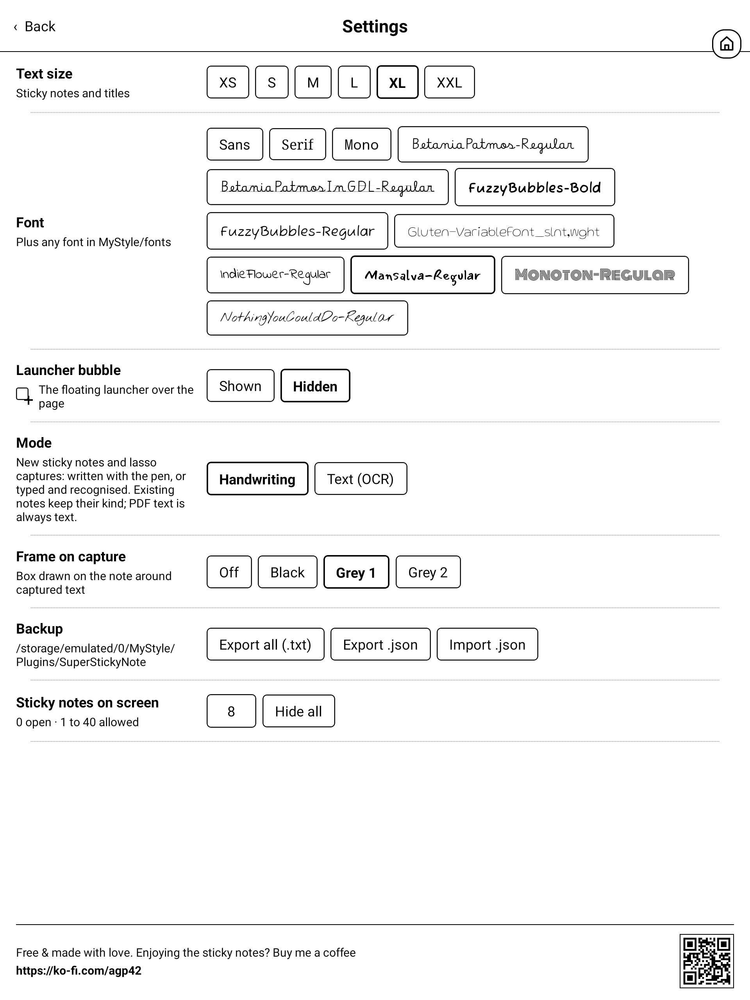

- **Text size** — XS · S · M · L · XL · XXL, applied to every sticky note.
- **Font** — **Sans / Serif / Mono**, plus any font you've dropped in `MyStyle/fonts`.
  Each one is **shown in its own typeface**, so you pick by looking, not by name.
- **Launcher bubble** — **Shown / Hidden**. When it's hidden you still create notes with
  **＋ New StickyNote**, or by capturing from a page.
- **Mode** — **Handwriting** or **Text (OCR)**: what *new* sticky notes are, from the
  bubble, the Manager and the lasso (§3, §7). Notes you already have keep their kind, and
  PDF text (§7) is always a typed note. Default **Text**.
- **Frame on capture** — **Off / Black / Grey 1 / Grey 2**: when you capture handwriting
  with the lasso, optionally draw a thin box **on the note** around what you captured, so
  you can see at a glance what was turned into a sticky note. A single thin line you can
  erase in one stroke. **Grey 1** is darker, **Grey 2** lighter. Default **Off**.
- **Backup** — see §8.
- **Sticky notes on screen** — how many may float at once: **8** by default, anything
  from **1 to 40**. Above 8 you'll see a warning: every floating note is a system overlay,
  and a screenful of them will slow the device down.

---

## 7. Capturing from a page

### Handwriting → sticky note

Lasso some handwriting, then tap **Add to StickyNote** in the lasso toolbar. A **new sticky
note** appears, following Settings → **Mode**:

- **Handwriting** — the strokes themselves, at their size on the page (shrunk only
  when they don't fit the screen). Instant. Tap ✎ to write more, or erase part of it.
- **Text (OCR)** — the recognised text, editable. Recognition takes a few seconds — a
  "Recognizing…" message shows while it works.

This works in a **notebook** *and* on **handwritten annotations in a PDF or EPUB**.

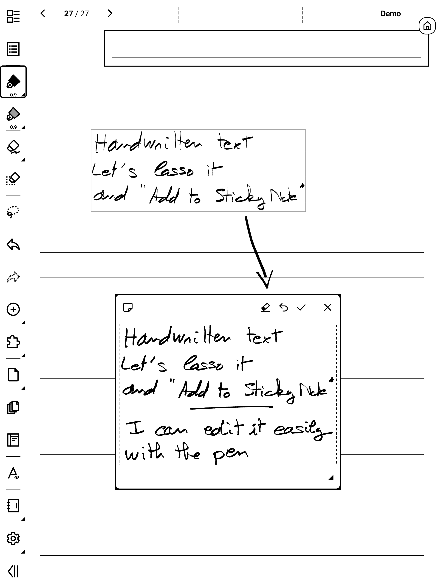

In **Text (OCR)** mode, the same lasso gives typed text — here from a PDF annotation:

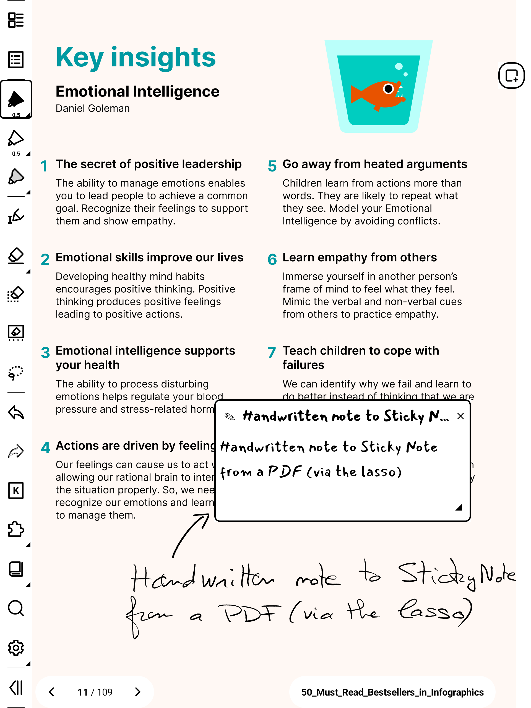

- The **lasso clears itself** once the capture is done. Your handwriting is untouched.
- Shapes and stars are kept as drawn in Handwriting mode, and a heading as its
  handwriting: the card doesn't show the heading's highlight, but a capture you didn't
  change goes back on the page as a heading (once changed in the card, as plain strokes); pictures, text boxes and links are not (a
  handwritten sticky note holds strokes only — the message says so). In **Text (OCR)**
  mode a **shapes-only** selection still makes a sticky note, describing what it found
  ("2 × Circle").
- Turn on **Frame on capture** (§6) to box what you captured — on a notebook page or a
  document, since the frame is a drawn shape.

### Underline a word to label the note

Draw a **clean straight underline** (the straight-line shape tool) under a word inside your
lasso selection, and that word becomes a **label** on the new sticky note. Underline three
words, get three labels. No underline, nothing happens — an ordinary capture is unchanged.

### PDF text → sticky note

Select text in a **PDF or EPUB** with the reader's text tool, then tap
**Add to StickyNote** in the selection toolbar that pops up — the circled button below.

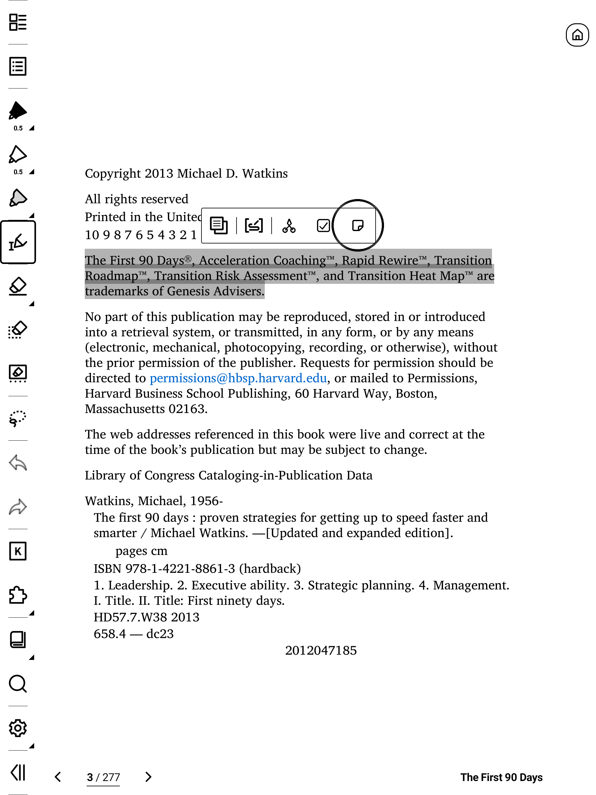

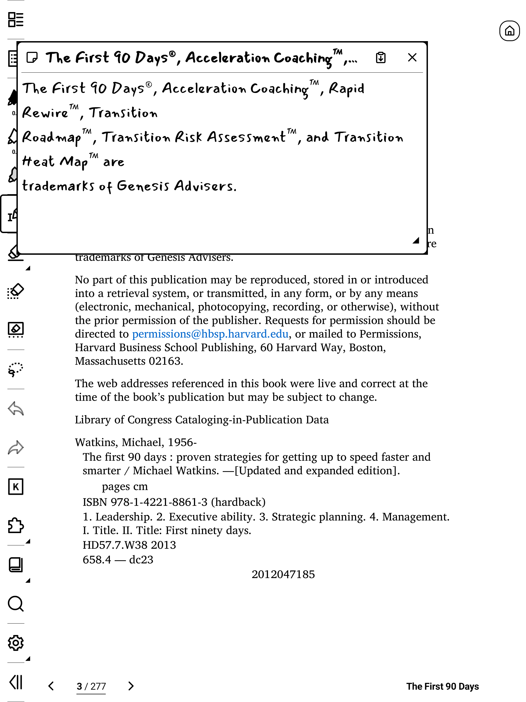

No recognition needed — the text is already text, so the sticky note appears instantly,
as a **typed** note whatever the Mode.

Every captured note keeps a **Go to source** backlink to its file and page.

---

## 8. Back on the page, and out

- **Put on page** (the clipboard icon in the card's header, or the button in the
  Manager) puts the sticky note on the **page underneath**:
  - **handwriting** as real strokes: lasso it, move it, erase it, convert it like anything
    you wrote. Written in the card, it lands in the middle of the page; a capture you
    didn't change lands as the firmware places it;
  - **text** as an editable text box, using the **Font** and **Text size** from Settings
    — on a notebook page only: a PDF or EPUB has no text boxes.
  - A note holding both (from before v3.1) puts its handwriting; **Put text on page** on
    its note page puts the text.

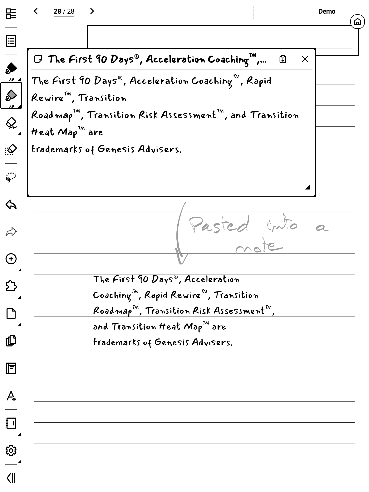

- From the Manager, it closes so you land on the result.
- **Copy** — on a typed note's page, copies the text to the clipboard.
- **Export** — on a typed note's page, saves that note as a `.txt`.
- **Backup / restore all** (Settings → Backup):
  - **Export all (.txt)** — one text file per typed note (handwritten notes have no text).
  - **Export .json** — a single `SuperStickyNote-notes.json` snapshot of everything, with
    the handwriting copied into the `SuperStickyNote-ink` folder next to it. Keep the two
    together.
  - **Import .json** — reads that backup and **adds** any notes you don't already have.
    It **never overwrites** existing notes, so it's safe.

Exports go to `MyStyle/Plugins/SuperStickyNote/` (visible over USB/MTP).

---

## 9. Where your notes live

Your notes live in the plugin's **private, hidden** storage (not in a synced folder), so
cloud sync can't corrupt them. Backups and exports go to the visible
`MyStyle/Plugins/SuperStickyNote/` folder.

---

## 10. Good to know / limits

- **Handwriting isn't searchable**: give a handwritten note a title or labels to find it.
- **The first stroke on a grey card goes to the page**: tap ✎ or hold the pen over the card
  before writing (§3).
- **If the pen ever stops writing in the notebook** after writing in a card, tap a pen
  tool in the notebook's toolbar: that resets the pen.
- **Moving a sticky note with the pen also draws on the note underneath** — the Supernote
  pen has a hardware path into the notebook that a plugin overlay can't intercept. Two ways
  around it: drag with your **finger**, or first select the **eraser** or **lasso** tool —
  then you can drag and resize with the pen without leaving a stroke.
- **Text goes back on notebook pages only.** A PDF or EPUB has no text boxes, so only
  handwriting can be put on a document page. Capturing *from* a PDF works fine, and so
  does the capture frame — a drawn shape, which a document accepts.
- **Pasting from other apps is limited by Android.** Since Android 10 an app may only read
  the clipboard while it holds the screen's focus, which a plugin doesn't — so text copied
  in another app can't be pulled into a sticky note. Copying *out* works.
- **Above 8 floating notes**, expect the device to get slower: each one is a system window.
- **If the bubble survives an uninstall**, restart the device. The plugin now clears its
  own overlays when it is torn down — reinstalling no longer leaves anything behind — but
  the bubble is a system window owned by the plugin host, so a teardown that never reaches
  us can still strand it.
- If a sticky note ever gets stuck after a firmware hiccup, force-stopping the plugin host
  (or restarting the device) clears any stray window.

---

## 11. Support

SuperStickyNote is free and made with love by a Supernote user, for Supernote users.
If it earns a spot on your screen, you can buy me a coffee:

**https://ko-fi.com/agp42**
